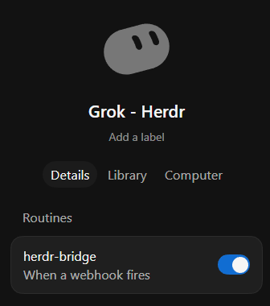

  

# Grok Bridge

**Grok Bot can now call your Claude and Codex.** A plugin for Grok Bot, built on [herdr](https://github.com/herdrdev/herdr).

## Install

Ask your coding agent in herdr:

> Read SETUP.md in this folder and set up Grok Bridge.

Needs herdr 0.9+ and Node 18+. Details: [docs/REFERENCE.md](docs/REFERENCE.md). License: MIT.
